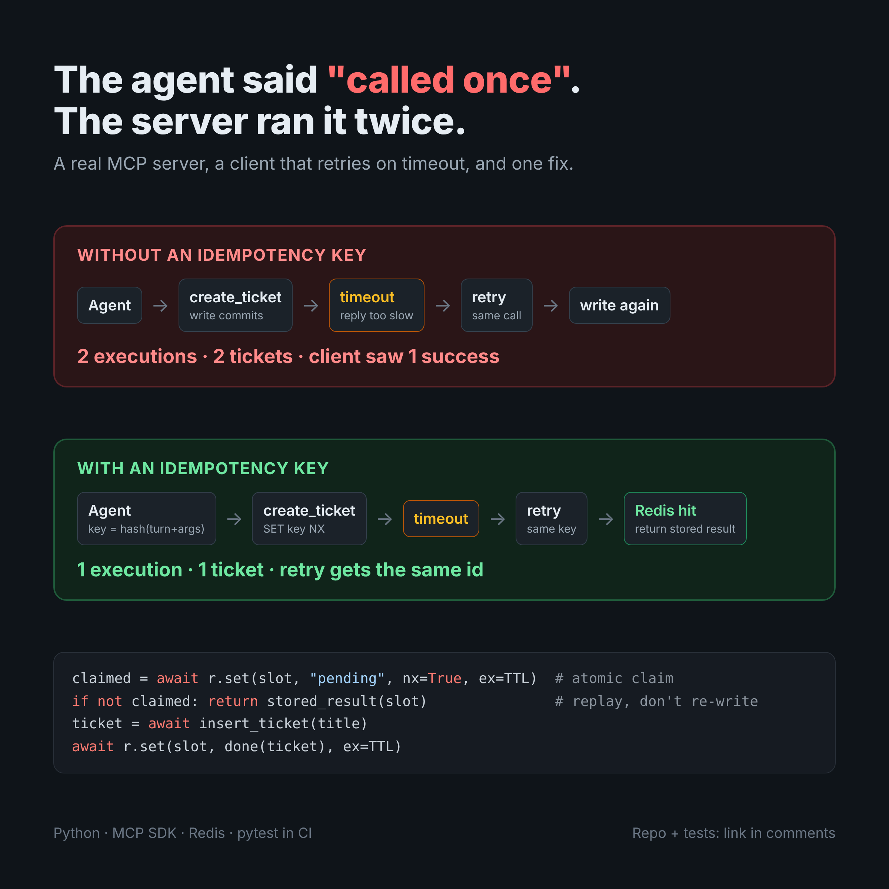

# mcp-idempotent-writes

**An agent said it called a write tool once. The server ran it twice.**

This repo reproduces that failure with a real MCP server and shows the fix: an idempotency key per intended action, with the first result stored in Redis and returned on every repeat.



## The failure

1. The agent calls `create_ticket_unsafe`. The server writes the ticket.
2. The reply is slow, so the client times out.
3. The client retries (many agent runtimes do this on timeouts). The server writes **again**.
4. The model only saw one successful result, so it reports "created 1 ticket".

The same pattern appeared in two public reports in November 2026: an [OpenAI developer forum bug](https://community.openai.com/t/responses-api-approved-native-mcp-write-executes-twice-after-a-programmatic-read/1416736) where one approved MCP write ran twice, and an [omadia issue](https://github.com/byte5ai/omadia/issues/1904) where timeouts caused silent retries of non-idempotent tools.

## The fix

`create_ticket` takes an `idempotency_key`:

```python
claimed = await r.set(slot, '{"status":"pending"}', nx=True, ex=TTL)   # atomic claim
if not claimed:
    stored = json.loads(await r.get(slot))
    return stored["result"] if stored["status"] == "done" else {"status": "in_progress"}
ticket = await insert_ticket(title)
await r.set(slot, json.dumps({"status": "done", "result": ticket}), ex=TTL)
```

The client builds one key per *intended action*, so a retry reuses it:

```python
key = sha256(f"{user}|{turn_id}|{tool}|{canonical_json(args)}")
```

Tools also declare MCP annotations (`readOnlyHint`, `idempotentHint`) so clients know what is safe to retry.

## Run it

```bash
pip install -r requirements.txt
python demo.py           # uses in-process fakeredis
pytest -q                # 6 tests, also run in CI

# against a real Redis
docker compose up -d
REDIS_URL=redis://localhost:6379/0 python demo.py
```

Output:

```
[1] create_ticket_unsafe  (no idempotency key)
  attempt 1: Timed out while waiting for response to ClientRequest. Waited 0.5 seconds. -> retrying
  attempt 2: ok -> {'id': 2, ...}
  server: 2 executions, 2 tickets   <-- duplicate

[2] create_ticket  (idempotency key, stored result in Redis)
  attempt 1: Timed out while waiting for response to ClientRequest. Waited 0.5 seconds. -> retrying
  attempt 2: ok -> {'id': 1, ..., 'replayed': True}
  server: 1 execution,  1 ticket    <-- retry replayed the stored result
```

## What the tests cover

- A retry without a key creates a duplicate (the bug, pinned as a test)
- A retry with a key executes once
- A replay returns the same ticket id, flagged `replayed: true`
- 10 concurrent calls with the same key execute once (atomic `SET NX`)
- Key derivation ignores argument order
- Tool annotations are exposed to clients

## Files

| File | What it does |
|---|---|
| `server.py` | FastMCP server: unsafe write, idempotent write, read-only counter. Also runs over stdio (`python server.py`) for MCP Inspector or Claude Desktop. |
| `client.py` | Retry-on-timeout client and idempotency key derivation |
| `demo.py` | Runs both scenarios against the same flaky network |
| `tests/` | pytest suite, run in GitHub Actions |

## Limits (on purpose, this is a demo)

- The key and the ticket write are two Redis calls. In production, put the write and the key record in one transaction, or pass the key on to the downstream API's own idempotency support.
- A crash between "pending" and "done" leaves the key pending until its TTL expires. A real system needs a shorter pending lease.
- The key includes the turn id, so the same request in a *new* turn creates a new ticket. That is usually what you want, but you may also want a warning for near-identical writes within a short window.
